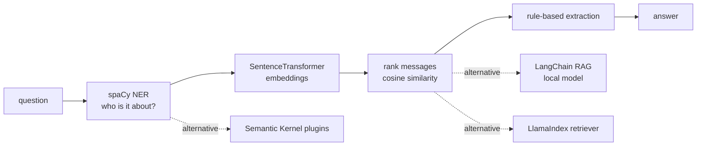

# Member Messages QA System

[](https://github.com/Deshraj-Jogiya/NLP-based-Q-A-system/actions/workflows/ci.yml) 

Answers natural-language questions about members from their unstructured messages. Questions are matched to messages with
SentenceTransformer embeddings, the person being asked about is found with spaCy NER, and specific details are extracted with rules. The
same data also runs through LlamaIndex, Semantic Kernel and a LangChain RAG chain.

## Highlights

- **Semantic search with an `/ask` API:** ranks messages by cosine similarity over `all-MiniLM-L6-v2` embeddings; `api.py` serves it as
  `POST /ask` (FastAPI) and `main.py` as an interactive prompt.
- **NER first:** spaCy NER with fuzzy first-name matching identifies the subject before ranking.
- **Extraction:** regex rules pull contact details, quantities and companion/group references, falling back to the closest message.
- **Approach chosen on purpose:** five designs were compared (rule-based matching, knowledge graphs, fine-tuned LLMs, hybrid retrieval,
  embeddings); see `alternate_readme.md`.
- **Three more paths over the same data:** a LlamaIndex `VectorStoreIndex` retriever, Semantic Kernel plugin functions orchestrated by a
  Kernel, and a retrieve-then-generate LangChain RAG chain running a local model.

## Architecture



## Stack

Python, Sentence-Transformers, spaCy, scikit-learn, pandas, LlamaIndex, Semantic Kernel, LangChain, FastAPI, pytest, GitHub Actions.

## Run it

```bash
pip install -r requirements.txt
python -m spacy download en_core_web_sm
python main.py                          # interactive prompt
uvicorn api:app --port 8000             # POST /ask {"question": "..."}
pytest test_api.py test_llamaindex_search.py test_semantic_kernel_plugin.py test_rag_chain.py -v
```
